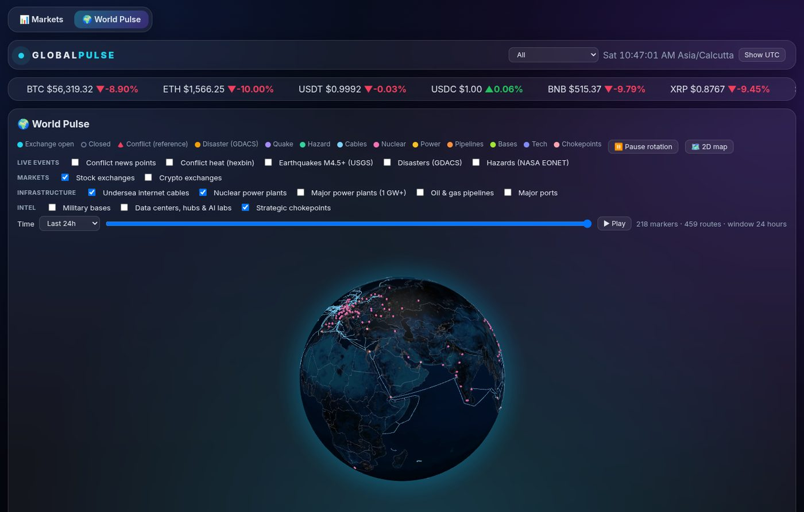
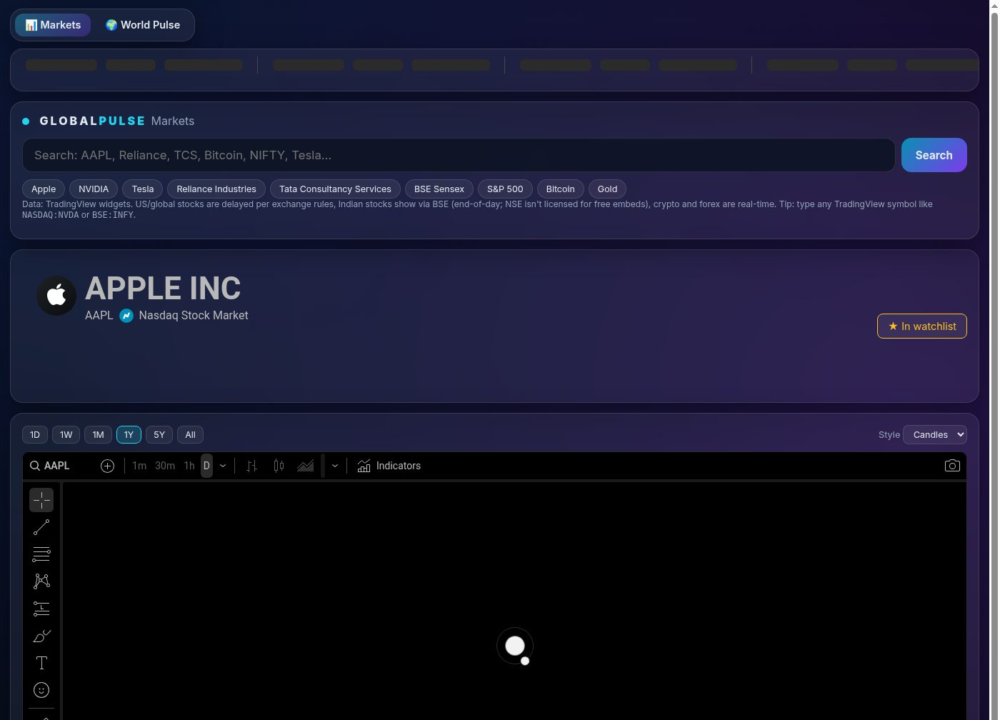
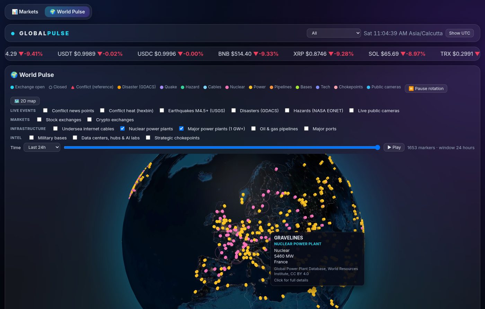
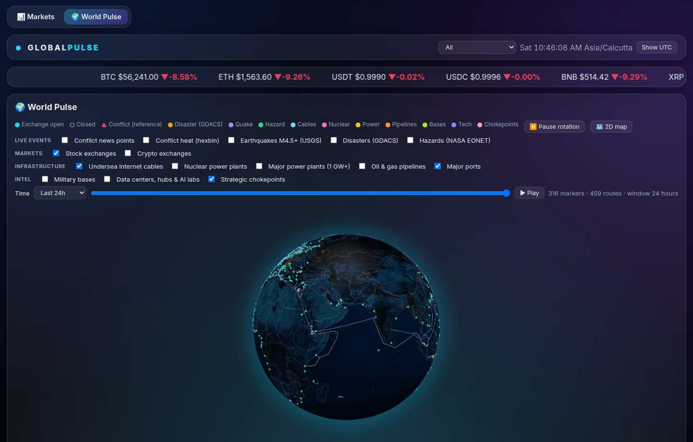
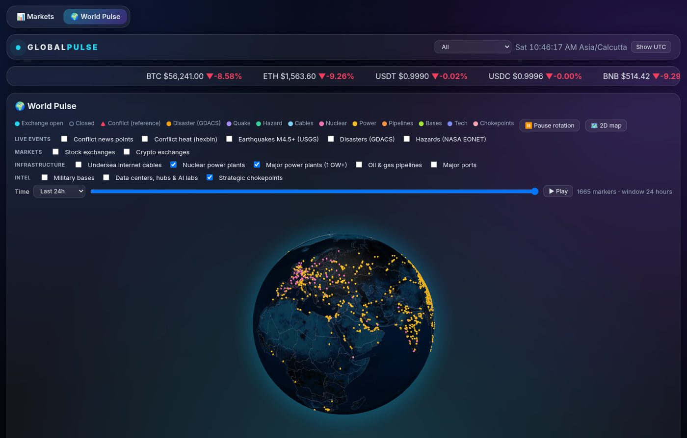
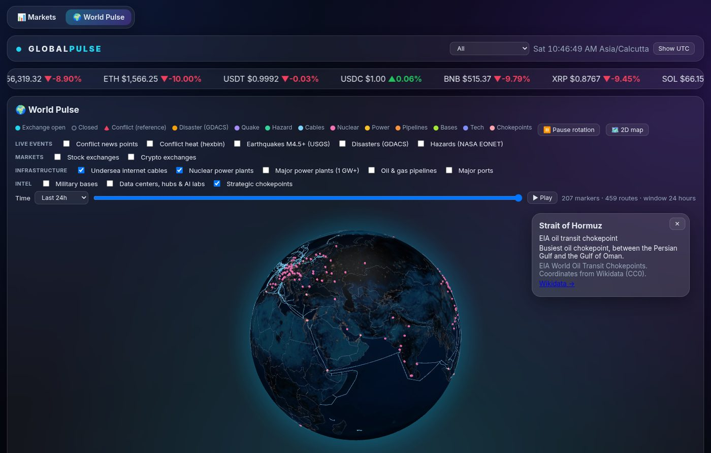
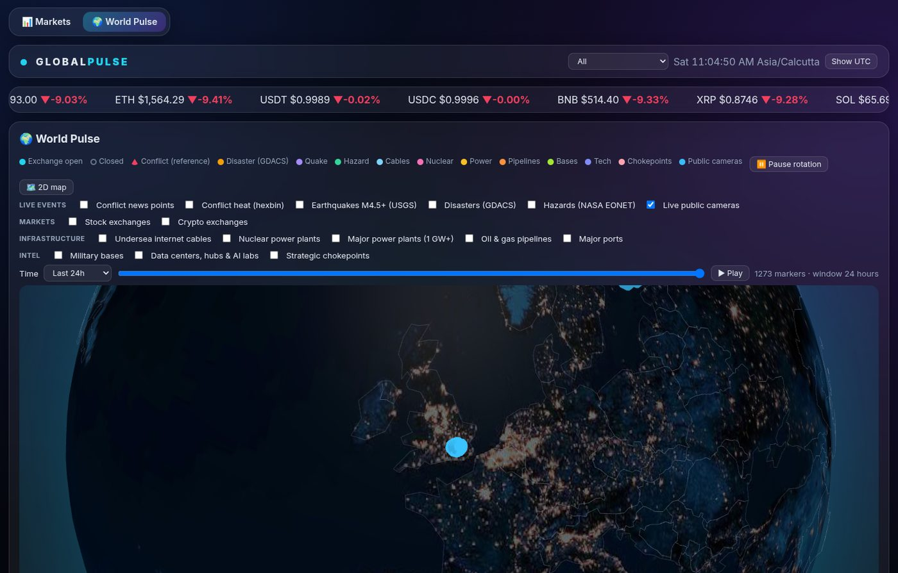
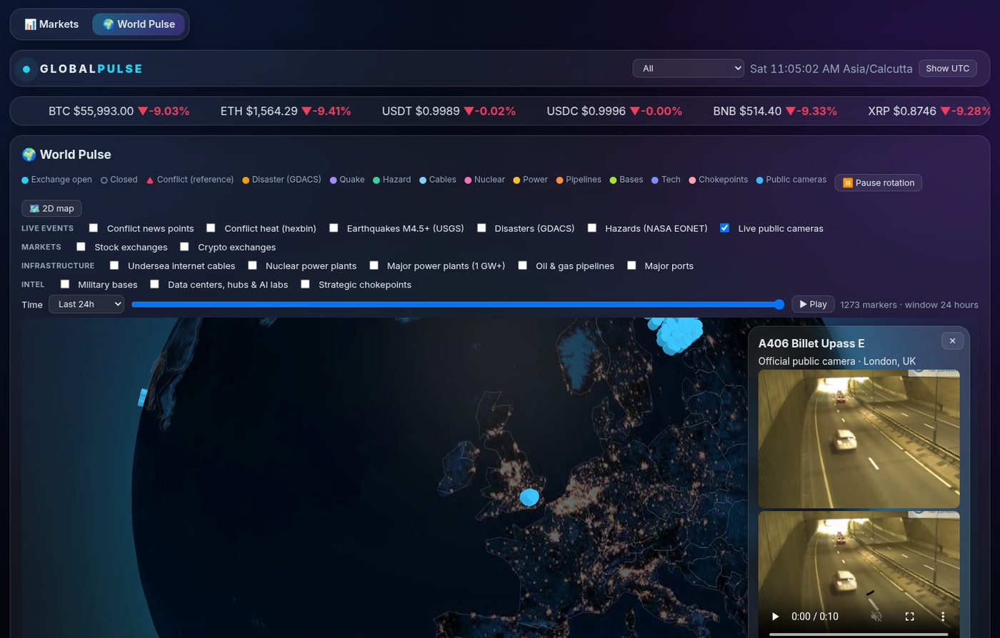

# Global Pulse

**Watch the markets. Watch the world.** A live stock-and-crypto desk plus a 3D intel globe — conflicts, disasters, infrastructure, and official public cameras — all from open, keyless data.

[](https://ashswin-git.github.io/global-pulse/)
[](https://github.com/ashswin-git/global-pulse/commits/main)

🔗 **Live:** [https://ashswin-git.github.io/global-pulse/](https://ashswin-git.github.io/global-pulse/)

> **🤖 Fully built by Grok Bot.** Idea and direction by [@ashswin-git](https://github.com/ashswin-git); code reviews and research help by my other Grok Bot assistants (Lll, Aproval and COA). All code was written by Grok Bot.

<p align="center">
  
</p>

<p align="center">
  
</p>

## Features

### Markets

The Markets desk (`index.html`, the default page) is a full symbol workspace built on free [TradingView embed widgets](https://www.tradingview.com/widget-docs/) — no API key, no proxy, no backend.

- **Symbol search** — stocks, indices, crypto, forex and commodities. Type a name or a TradingView ticker (`NASDAQ:NVDA`, `BSE:INFY`, `BINANCE:BTCUSDT`).
- **Interactive charts** — candlesticks with 1D / 1W / 1M / 1Y / 5Y / All ranges, plus quote header, key stats, company profile, technicals and related news.
- **Watchlist** — save symbols in `localStorage` and jump back to them.
- **Gainers and losers** — hotlists for the US, India, the UK and Japan, a crypto heatmap, and a market overview.
- **Crypto** — top coins by market cap, live prices, 24h change, 7-day sparklines, global market-cap and BTC/ETH dominance, and a scrolling ticker (refreshed about every 60 seconds). Prices come from [CoinGecko](https://www.coingecko.com/en/api), with [CoinPaprika](https://api.coinpaprika.com) as a fallback; a public Binance ticker is also used for quotes.

Widget freshness follows TradingView’s licensing: crypto and forex are real-time; US and most global stocks are delayed (~15 minutes); India is shown via **BSE** (end-of-day — NSE is not licensed for free embeds).

### World Pulse

World Pulse (`world.html`) is an animated 3D globe ([globe.gl](https://github.com/vasturiano/globe.gl) / three.js) with a Leaflet 2D map fallback for mobile or machines without WebGL. Toggle layers in the panel; your selection is stored in the URL.

- **Hover tooltips** — move the cursor over any point or route for the name, type, key stats and source, immediately, with no click. Updates are throttled to an animation frame so dense layers stay smooth.
- **Click popups** — the details panel opens with the full record, source and licence, plus a live image or official stream for cameras.
- **Time slider** — filter live events to the last 24 hours or 7 days, with an optional Play animation (disabled when `prefers-reduced-motion` is set).
- **Shareable URL** — `layers`, `region`, `t`, `at`, `pov` and `view` are written into the query string so a view can be bookmarked or sent on.
- **Country briefing** — click a country for recent headlines, disasters and quakes, with a link through to its main index on Markets.
- **Keyword watch and near-me alerts** — optional browser notifications (watch words stay in `localStorage`; location is rounded and stored only locally).
- **Arcs** — major events (Red GDACS alerts, M6+ quakes, large conflict clusters) connect to the nearest of the 11 tracked stock exchanges.

<p align="center">
  
</p>

#### Layers

New intel and camera layers are off by default — turn them on in the panel. Counts are from the extracts committed in this repository.

**Live events**

| Layer | What you see | Count / window |
| --- | --- | --- |
| Conflict news points | Geo-located headlines from [GDELT DOC 2.0](https://blog.gdeltproject.org/gdelt-doc-2-0-api-debuts/), with a labelled static hotspot list as fallback | Live, last 24h / 7d |
| Conflict heat (hexbin) | Density of those conflict points | Live |
| Earthquakes M4.5+ | [USGS](https://earthquake.usgs.gov/) all-week feed | Snapshot, ~100 events |
| Disasters (GDACS) | Orange/Red alerts: cyclones, floods, volcanoes, wildfires, droughts and more, from [GDACS](https://www.gdacs.org) | Snapshot, 81 events |
| Hazards (NASA EONET) | Natural events from [NASA EONET](https://eonet.gsfc.nasa.gov/) v3 | Snapshot, 8 events |
| Live public cameras | Official traffic and road-weather webcams only (see below) | 1,273 cameras |

**Markets on the globe**

| Layer | What you see | Count |
| --- | --- | --- |
| Stock exchanges | 11 major venues (NYSE/Nasdaq, TSX, B3, LSE, Xetra, Euronext Paris, BSE, SSE, HKEX, TSE, ASX). Open/closed status is computed in-browser from official hours and time zones | 11 |
| Crypto exchanges | Headquarters / registered locations from Wikidata. Live prices stay on the Markets desk | 45 |

**Infrastructure**

| Layer | What you see | Count |
| --- | --- | --- |
| Undersea internet cables | Named OSM submarine communication cables (simplified). Coverage is incomplete compared with commercial cable maps | 226 |
| Nuclear power plants | Every nuclear plant in the [WRI Global Power Plant Database](https://github.com/wri/global-power-plant-database) v1.3.0 | 195 |
| Major power plants (1 GW+) | Non-nuclear plants of 1,000 MW or more, same WRI database (last release 2021) | 1,458 |
| Oil & gas pipelines | Named OSM oil/gas pipeline relations and long independent ways (≥ 250 km), simplified | 311 |
| Major ports | [Natural Earth](https://www.naturalearthdata.com/downloads/10m-cultural-vectors/ports/) 10m ports, scalerank ≤ 5 | 293 |

**Intel**

| Layer | What you see | Count |
| --- | --- | --- |
| Military bases | Public US DoD sites from [NTAD](https://geodata.bts.gov/) plus notable Wikidata bases, de-duplicated. Not a complete world inventory | 777 |
| Data centers, hubs & AI labs | Notable Wikidata items: 69 data centers, 32 tech hubs, 15 internet exchanges, 62 AI labs | 178 |
| Strategic chokepoints | Eight [EIA World Oil Transit Chokepoints](https://www.eia.gov/international/analysis/special-topics/World_Oil_Transit_Chokepoints) plus four clearly labelled extras (Gibraltar, Taiwan Strait, Lombok, Dover) | 12 |

<p align="center">
  
  
</p>

<p align="center">
  
</p>

### Live public cameras

A dedicated layer of **official, explicitly public** traffic and road-weather cameras. Private, login-walled, or unprotected CCTV (Insecam, Shodan-style open cameras) is not included. Hover shows the name and place; click shows a live still, a short official clip, or a stream / agency page.

| Source | Cameras | Licence / terms |
| --- | --- | --- |
| [TfL JamCams](https://tfl.gov.uk/corporate/terms-and-conditions/transport-data-service) (London) | 801 | Open Government Licence (UK). Contains OS data © Crown copyright. **Powered by TfL Open Data.** JPEG stills and short official MP4 clips. |
| [Caltrans CWWP2](https://cwwp2.dot.ca.gov/documentation/cctv/cctv.htm) (California DOT) | 283 | Public traveler-information service. Sampled (up to 25 in-service cameras with an image per district). Attribution: Caltrans. |
| [Fintraffic Digitraffic](https://www.digitraffic.fi/en/road-traffic/weathercam/) weather cameras (Finland) | 116 | [CC BY 4.0](https://creativecommons.org/licenses/by/4.0/). Attribution: Fintraffic / Digitraffic. Official preset stills. |
| [Delaware DOT TMC](https://tmc.deldot.gov/) | 73 | Public traveler-information service. Attribution: DelDOT. Live HLS streams and the official TMC page (no reliable still URL). |

**1,273 cameras in total** (1,200 with a still image). Windy Webcams, Ontario 511 and several other official APIs were skipped because they require a key or did not return a usable public feed.

<p align="center">
  
  
</p>

### Conflict briefing

The World Pulse news column opens with a briefing drawn from public RSS feeds, then GDELT headlines for the selected place.

Feeds used (all keyless, no login):

- [UN News](https://news.un.org/) and [Al Jazeera](https://www.aljazeera.com/) — every item in the feed
- [BBC World](https://www.bbc.com/news/world), [The Guardian World](https://www.theguardian.com/world), [DW World](https://www.dw.com/) and [France 24](https://www.france24.com/) — items that match conflict-related keywords

[ACLED](https://acleddata.com/) is not used (it requires registration and an API key). ReliefWeb’s JSON API v2 needs a pre-approved application name, so it is not called.

## Automatic data refresh

Snapshots under `data/` (GDELT news and points, the RSS conflict briefing, GDACS, USGS earthquakes, NASA EONET, and the official camera list) are meant to be refreshed by a **scheduled GitHub Actions job every 4 hours**, plus manual `workflow_dispatch`. The job commits changed files as `github-actions[bot]` using the default `GITHUB_TOKEN` (`contents: write`). No personal secrets. The site reads those snapshots first if they are less than 8 hours old, and only then falls back to live API calls (which avoids GDELT rate limits). A failed source keeps its previous file and is marked in `data/meta.json`.

**Status: coming soon.** The workflow file is ready in the project but is not on `main` yet — publishing it needs a git credential with the `workflow` scope. Until it is merged, the live site uses the last committed snapshots and in-browser fallbacks. You can refresh the same files locally with the scripts below.

Static intel extracts (cables, plants, pipelines, ports, bases, tech sites, chokepoints) are built once and are not part of the 4-hour refresh.

## Data sources and licences

All default sources are free and keyless. Bundled extracts are slim, redistributable snapshots — datasets that cannot be redistributed (for example TeleGeography cable GeoJSON) are not included. See also [`data/intel/SOURCES.md`](data/intel/SOURCES.md).

| Data | Source | Licence | How it is used |
| --- | --- | --- | --- |
| Markets charts, quotes, screeners, news | [TradingView embed widgets](https://www.tradingview.com/widget-docs/) | TradingView widget terms | Live embeds on the Markets desk |
| Crypto prices and global market stats | [CoinGecko](https://www.coingecko.com/en/api), fallback [CoinPaprika](https://api.coinpaprika.com); Binance public ticker for some quotes | Respective API terms (keyless) | Live in the browser, cached in `localStorage` |
| Conflict news and map points | [GDELT DOC 2.0](https://blog.gdeltproject.org/gdelt-doc-2-0-api-debuts/) | GDELT terms (keyless, rate-limited to about 1 request / 5 s) | Snapshot + live fallback |
| Conflict briefing | Public RSS: UN News, BBC World, The Guardian, Al Jazeera, DW, France 24 | Each outlet’s RSS terms | `data/conflict.json` |
| Disasters | [GDACS](https://www.gdacs.org) events API | GDACS terms | `data/gdacs.json` + live fallback |
| Earthquakes | [USGS](https://earthquake.usgs.gov/) M4.5+ week feed | US government work, public domain | `data/quakes.json` + live fallback |
| Natural hazards | [NASA EONET](https://eonet.gsfc.nasa.gov/) v3 | NASA open data | `data/eonet.json` + live fallback |
| Undersea cables | OpenStreetMap named submarine communication cables | [ODbL 1.0](https://www.openstreetmap.org/copyright) | `data/intel/cables.json` (226, simplified) |
| Oil & gas pipelines | OpenStreetMap named oil/gas pipelines | [ODbL 1.0](https://www.openstreetmap.org/copyright) | `data/intel/pipelines.json` (311, simplified) |
| Nuclear & major power plants | [WRI Global Power Plant Database](https://github.com/wri/global-power-plant-database) v1.3.0 (2021) | [CC BY 4.0](https://creativecommons.org/licenses/by/4.0/) | `data/intel/nuclear.json` (195), `power.json` (1,458) |
| Major ports | [Natural Earth](https://www.naturalearthdata.com/downloads/10m-cultural-vectors/ports/) 10m ports | Public domain | `data/intel/ports.json` (293, scalerank ≤ 5) |
| Military bases | USDOT/BTS [NTAD Military Bases](https://geodata.bts.gov/) + Wikidata | US government work (public domain) + [CC0](https://creativecommons.org/publicdomain/zero/1.0/) | `data/intel/bases.json` (777) |
| Tech hubs, data centers, AI labs, crypto-exchange locations, chokepoint coordinates | [Wikidata](https://www.wikidata.org/) | [CC0](https://creativecommons.org/publicdomain/zero/1.0/) | `data/intel/tech.json` (178), `crypto-exchanges.json` (45) |
| Strategic chokepoints (list) | [U.S. EIA World Oil Transit Chokepoints](https://www.eia.gov/international/analysis/special-topics/World_Oil_Transit_Chokepoints) | US government work, public domain | `data/intel/chokepoints.json` (8 EIA + 4 labelled extras) |
| Live public cameras | TfL JamCams, Caltrans CWWP2, Fintraffic Digitraffic, Delaware DOT TMC | OGL / Powered by TfL Open Data; Caltrans public traveler info; Fintraffic CC BY 4.0; DelDOT public TMC | `data/intel/cameras.json` (1,273) |
| Country shapes | [world-atlas](https://github.com/topojson/world-atlas) (Natural Earth) | Public domain / ISC | 3D polygons and 2D countries |
| Map tiles (2D view) | [OpenStreetMap](https://www.openstreetmap.org/copyright) | ODbL 1.0 | Leaflet fallback |
| Optional index quotes | [Finnhub](https://finnhub.io) (only if you add your own free key in `config.js`) | Finnhub terms | Otherwise index tiles are clearly labelled **DEMO** |

Country shapes and map tiles © OpenStreetMap contributors where applicable. Camera stills remain the property of the publishing agency; this project only links to or displays official public feeds, with the required attribution.

## Built with

Only tools and libraries this project actually uses:

- **Front end** — plain HTML, CSS and vanilla JavaScript. No framework, no bundler, no build step.
- **[TradingView embed widgets](https://www.tradingview.com/widget-docs/)** — all Markets charts, quotes, screeners and news.
- **[globe.gl](https://github.com/vasturiano/globe.gl) 2.33** (MIT; three.js) — 3D globe, hexbins, paths and arcs, loaded from jsDelivr with SRI.
- **[Leaflet](https://leafletjs.com) 1.9.4** (BSD-2-Clause) + **[Leaflet.markercluster](https://github.com/Leaflet/Leaflet.markercluster) 1.5.3** (MIT) — 2D map fallback, OSM tiles.
- **[topojson-client](https://github.com/topojson/topojson-client)** (ISC) + **[world-atlas](https://github.com/topojson/world-atlas)** (ISC) — country shapes.
- **Hosting** — GitHub Pages, served statically from `main`.
- **Data scripts** — Node.js 20 (`scripts/fetch-data.mjs`, `scripts/fetch-cameras.mjs`, built-in `fetch`, no npm dependencies) and Python 3 (`scripts/build-intel.py`).

Ideas only — **no code copied** — from [koala73/worldmonitor](https://github.com/koala73/worldmonitor), [hipcityreg/situation-monitor](https://github.com/hipcityreg/situation-monitor), and similar open dashboards. [Open-Dev-Society/OpenStock](https://github.com/Open-Dev-Society/OpenStock) inspired the Markets widget layout and the “chart Indian stocks through BSE” pattern (AGPL; no code copied). [tradingview/lightweight-charts](https://github.com/tradingview/lightweight-charts) was evaluated but needs a first-party OHLC feed, which no keyless browser-accessible source provides.

## Run locally

```bash
git clone https://github.com/ashswin-git/global-pulse
cd global-pulse
python3 -m http.server 8000
# open http://localhost:8000          — Markets
# open http://localhost:8000/world.html — World Pulse
```

A simple static server is enough (Python, `npx serve`, Caddy, …). Opening the files as `file://` will block some fetches.

### Optional live index prices

Get a free key at [finnhub.io](https://finnhub.io) and put it in `config.js`:

```js
window.GP_CONFIG = { FINNHUB_KEY: "your_key_here" };
```

With a key, country tiles switch to **LIVE** quotes for ETF proxies (SPY, QQQ, EWU, EWG, INDA, EWJ, …). A key in a static site is visible to every visitor — **use a free-tier key only, never a paid Finnhub key.** Without a key, those tiles stay clearly labelled DEMO. Keyless index CSV sources (for example Stooq) block browser (CORS) access.

### TradingView symbol notes

Verified 2026-10-29 against free TradingView embeds. These symbols are **not** available in free embeds: `SP:SPX`, `NASDAQ:NDX`, `DJ:DJI`, `TVC:NI225`, `TVC:UKX`, `TVC:HSI`, `NSE:*` (including Nifty / Bank Nifty), `LSE:SHEL`, `TSE:7203`, `HKEX:700`, `TVC:DXY`. Substitutes are auto-aliased in search and the URL (S&P / Nasdaq / Dow / FTSE → FOREXCOM CFDs; Nikkei → `INDEX:NKY`; Hang Seng → `INDEX:HSI`; Nifty 50 / Bank Nifty → `BSE:NIFTYBEES` / `BSE:BANKBEES` ETF proxies; Shell / Toyota / Tencent → ADRs). Renamed BSE tickers: Zomato → `BSE:ETERNAL`, Tata Motors → `BSE:TMPV`, M&M → `BSE:M_M`, Bajaj Auto → `BSE:BAJAJ_AUTO`.

## Rebuild the data

Refresh the live snapshots (news, conflict briefing, disasters, quakes, hazards, cameras):

```bash
node scripts/fetch-data.mjs      # GDELT, RSS briefing, GDACS, USGS, EONET → data/*.json
node scripts/fetch-cameras.mjs   # official camera inventories → data/intel/cameras.json
```

GDELT calls are spaced at least 7 seconds apart. If a source fails, its previous file is kept and `data/meta.json` records the error. The official camera script also keeps the previous items for a source that fails mid-run.

Rebuild the static intel layers (cables, plants, pipelines, ports, bases, tech, chokepoints) only when those extracts need updating. This is heavier (Overpass, Wikidata SPARQL, WRI CSV) and is **not** part of the 4-hour refresh:

```bash
python3 scripts/build-intel.py   # writes data/intel/*.json and SOURCES.md
```

`build-intel.py` expects raw inputs under `/tmp/gp-intel/` as described in the script and in [`data/intel/SOURCES.md`](data/intel/SOURCES.md).

## Project structure

```
global-pulse/
├── index.html              Markets desk
├── world.html              World Pulse globe / 2D map
├── app.js, world2.js       World Pulse logic and layers
├── markets.js, markets.css Markets desk
├── style.css, sw.js        Shared UI and a small service-worker cache
├── config.js               Optional Finnhub key (empty by default)
├── data/
│   ├── conflict.json, gdacs.json, quakes.json, eonet.json, meta.json
│   └── intel/              Static + camera extracts and SOURCES.md
├── scripts/
│   ├── fetch-data.mjs      News, briefing, disasters, hazards
│   ├── fetch-cameras.mjs   Official public cameras
│   └── build-intel.py      One-shot intel-layer builder
└── docs/screenshots/       README images
```

## Contributing

Issues and pull requests are welcome. A few ground rules:

- Keep the site static, keyless by default, and small enough for GitHub Pages.
- Do not add datasets that cannot be redistributed, or anything that needs a personal secret in the repo.
- Official public cameras only — never Insecam, Shodan-style open CCTV, or feeds that bypass a login.
- Preserve upstream attribution and licences in `data/intel/SOURCES.md`, file `meta` blocks, and the footer.
- Please do not force-push `main`.

## Licence

This repository does not currently include a top-level `LICENSE` file for the source code. Reused data extracts and embeds keep their upstream licences (ODbL, CC BY 4.0, CC0, OGL / TfL, US government work, and the terms of TradingView, CoinGecko, GDELT and the other live APIs). Respect those terms if you reuse the extracts or screenshots.

⚠️ Not financial advice. Demo data is always labelled as demo. News and map layers are a public-data overview, not an official warning service.

**Hosting:** GitHub Pages, served statically from `main`.
