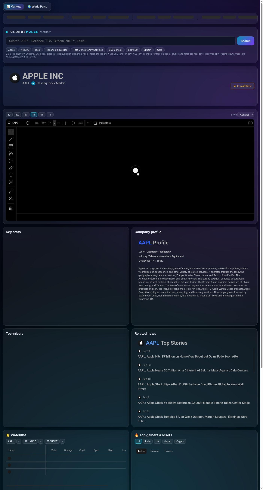
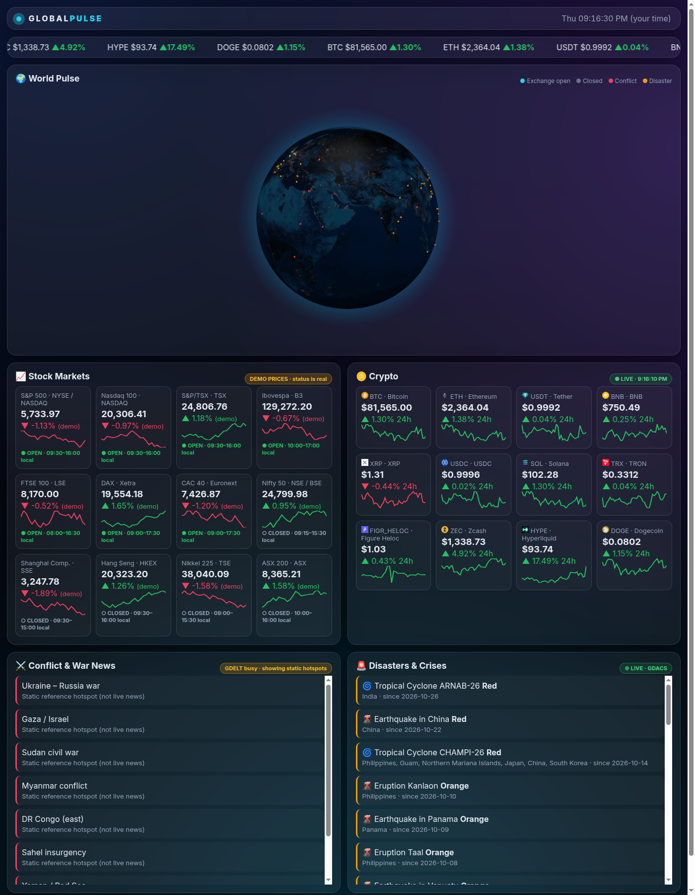

# 🌍 Global Pulse

**A stock search platform plus a live world dashboard.**

- 📊 **Markets** (`/`): search any stock, index, crypto, forex or commodity → interactive candlestick chart (1D/1W/1M/1Y/5Y/All), quote header, key stats, company profile, technicals, related news, a saved watchlist, top gainers/losers (US, India, UK, Japan, crypto heatmap) and a market overview.
- 🌍 **World Pulse** (`/world.html`): 3D globe of exchanges, conflicts and disasters, crypto prices and crisis feeds.

🔗 **Live:** https://ashswin-git.github.io/global-pulse/





## ✨ Features
- **3D animated globe** (globe.gl / three.js): pulsing rings for open stock exchanges, conflict hotspots and live disaster alerts; auto-rotates, drag to explore.
- **Stock markets**: 12 major indices (S&P 500, Nasdaq, FTSE, DAX, Nifty 50, Nikkei, Hang Seng…). **Open/closed status computed live from real exchange hours** in each exchange's time zone.
- **Crypto**: top 12 coins by market cap, live prices, 24h change, 7-day sparklines and a scrolling ticker tape (refresh every 60s).
- **Conflict & war news**: latest English headlines from GDELT (last 24h).
- **Disasters & crises**: Orange/Red alerts (cyclones, earthquakes, floods, volcanoes, wildfires, droughts) from GDACS, also plotted on the globe.
- Dark glassmorphism UI, smooth entrance animations, fully responsive (mobile friendly).
- Zero build step, zero backend, zero required API keys.

## 📊 Markets data
All Markets widgets are the free, keyless [TradingView embeddable widgets](https://www.tradingview.com/widget-docs/) (Advanced Chart, Symbol Info, Fundamental Data, Company Profile, Technical Analysis, Timeline, Market Quotes, Hotlists, Crypto Heatmap, Ticker Tape, Market Overview). No API key, no proxy, no backend.

| Market | Freshness in widgets (TradingView's licensing) |
|---|---|
| Crypto, forex | Real-time |
| US & most global stocks | Delayed (~15 min, per exchange) |
| India | Shown via **BSE** (end-of-day). NSE is not licensed for free embeds, so `NSE:` symbols show "only available on TradingView" |
| China SSE/SZSE, Hang Seng indices | End-of-day |

## 🙏 Credits & approach
- **[TradingView widgets](https://www.tradingview.com/widget-docs/)**: all Markets charts and data (attribution kept in the widgets and footer).
- **[tradingview/lightweight-charts](https://github.com/tradingview/lightweight-charts)** (Apache-2.0, ~17.7k★): evaluated. It needs your own OHLC feed, and no keyless browser-accessible feed exists (Yahoo/Stooq block CORS), so widgets were the better fit. Ready for Phase 3 behind a proxy.
- **[Open-Dev-Society/OpenStock](https://github.com/Open-Dev-Society/OpenStock)** (AGPL-3.0, ~21k★): inspired the widget-based layout and the "chart Indian stocks through BSE" pattern. **No code copied** (AGPL).
- **OpenBB**: reviewed; it's a Python platform and needs a server, so not used.
- [globe.gl](https://github.com/vasturiano/globe.gl) (MIT), CoinGecko, CoinPaprika, GDELT and GDACS power World Pulse.

## 📡 World Pulse data sources
| Section | Source | Status |
|---|---|---|
| Crypto | [CoinGecko](https://www.coingecko.com/en/api), fallback [CoinPaprika](https://api.coinpaprika.com) | ✅ Live, keyless, USD/INR, cached in localStorage |
| Disasters | [GDACS](https://www.gdacs.org) events API | ✅ Live, keyless |
| Conflict news | [GDELT DOC 2.0](https://blog.gdeltproject.org/gdelt-doc-2-0-api-debuts/) | ✅ Live, keyless (rate-limited to ~1 req / 5 s; falls back to a labelled static hotspot list) |
| Exchange open/closed | Computed in-browser from official trading hours | ✅ Real |
| Index prices | Built-in **DEMO** numbers (clearly labelled) | ⚠️ Demo unless you add a key |
| Conflict points on globe | GDELT GEO 2.0 (24h), fallback static reference list | ✅ Live when GDELT responds |

### Optional live stock prices
Get a free key at [finnhub.io](https://finnhub.io) and put it in `config.js`:
```js
window.GP_CONFIG = { FINNHUB_KEY: "your_key_here" };
```
With a key, tiles switch to **LIVE** quotes for country ETF proxies (SPY, QQQ, EWU, EWG, INDA, EWJ…). ⚠️ A key in a static site is visible to every visitor. **Use a free-tier key only — never a paid Finnhub key.**

Why demo? Keyless index sources were tested: Stooq's CSV endpoint does not allow browser (CORS) access, so live index prices need a key.

## 🛠 Stack
Plain HTML + CSS + vanilla JS · [globe.gl](https://github.com/vasturiano/globe.gl) via CDN · GitHub Pages.

## 🚀 Run locally
```bash
git clone https://github.com/ashswin-git/global-pulse
cd global-pulse
python3 -m http.server 8000   # open http://localhost:8000
```

## ✅ Phase 2 (done)
LIVE / CACHED / ERROR tags with last-updated time, localStorage caching, fetch timeouts and retries, GDELT backoff, CoinPaprika fallback, INR toggle, globe click → details panel + news filter, region filter, lunch breaks and some holidays, WebGL/CDN fallback, accessibility (skip link, focus styles, legend shapes, aria), local/UTC clock, OG/Twitter tags and favicon, reduced-motion support.

## 🔎 Symbol notes (verified 2026-10-29 in free TradingView embeds)
- Not available in free embeds: `SP:SPX`, `NASDAQ:NDX`, `DJ:DJI`, `TVC:NI225`, `TVC:UKX`, `TVC:HSI`, `NSE:*` (incl. NIFTY/BANKNIFTY), `LSE:SHEL`, `TSE:7203`, `HKEX:700`, `TVC:DXY`.
- Substitutes used (auto-aliased in search/URL): S&P/Nasdaq/Dow/FTSE → FOREXCOM CFDs (`SPXUSD`, `NSXUSD`, `DJI`, `UKXGBP`); Nikkei → `INDEX:NKY`; Hang Seng → `INDEX:HSI`; Nifty 50 / Bank Nifty → `BSE:NIFTYBEES` / `BSE:BANKBEES` ETFs (labelled as ETF proxies); Shell/Toyota/Tencent → ADRs.
- Renamed BSE tickers: Zomato → `BSE:ETERNAL`, Tata Motors → `BSE:TMPV`, M&M → `BSE:M_M`, Bajaj Auto → `BSE:BAJAJ_AUTO`.
- Unknown symbols (not in the verified list) show a notice; widgets themselves cannot be inspected cross-origin.

## 🗺 Roadmap
- Geo-located conflict events (GDELT GEO / ACLED) instead of the static hotspot list
- Full exchange holiday calendars
- Watchlist saved in localStorage, search, and alerts
- Fear & Greed / volatility widgets, PWA install

⚠️ Not financial advice. Demo data is always labelled as demo.
